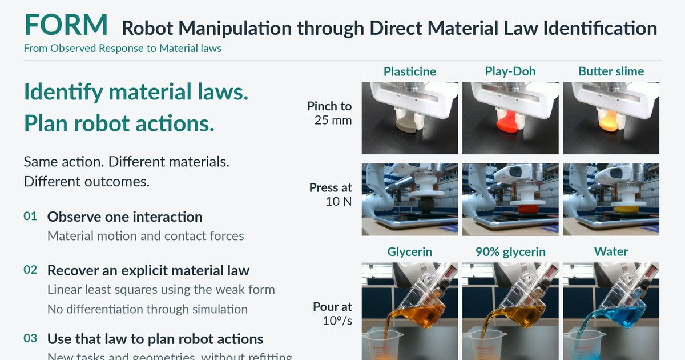

# FORM: Robot Manipulation through Direct Material Law Identification

[](https://arxiv.org/abs/2609.38105)
[](https://form-robots.github.io/)
[](https://github.com/form-robots/FORM)
[](https://form-robots.github.io/#video)
[](https://github.com/form-robots/FORM)

[](https://form-robots.github.io/)

FORM (From Observed Response to Material laws) identifies the material law of a deformable material from one robot interaction. The robot then uses that law in a material point method (MPM) simulator to plan new actions on new geometries.

Stepan Tretiakov, Ruihan Zhao, Cheng-Hsi Hsiao, Xingjian Li, Adam Thorpe, Hassan Iqbal, Sandeep Chinchali, Ufuk Topcu, Krishna Kumar

UC Berkeley and UT Austin

## How it works

1. The robot presses, bends, or pours the material once. Cameras track the material motion, and the robot records the contact forces.
2. A weak-form momentum balance turns the tracked motion and forces into linear equations in the material coefficients. One least-squares solve returns the coefficients. The method never differentiates through the simulator.
3. MPM predicts the outcome of candidate motions with the identified law held fixed. The planner picks the motion with the lowest task cost, and the robot executes it open loop.

The weak form uses divergence-free test fields, so the unknown pressure drops out of every equation. The test fields vanish at both ends of each time window, so the equations need no measured accelerations. The stress is linear in the coefficients, and each test field adds one linear equation. The test fields are the quadratic B-splines of the MPM solver, so the identified coefficients go into the simulator without refitting or conversion.

## Results

| Quantity | Value |
| --- | --- |
| Identification time from full observations | 2 to 5 s, against roughly 10 to 25 min for iterative baselines |
| Error in identified elastic moduli | at most 3.4% |
| Error in identified elastoplastic parameters | under 2% |
| Footprint IoU after open-loop shaping of three real materials | 72.4% to 77.8% |
| Largest mean pouring error over six targets from 60 to 160 mL | 3.8 mL |

The paper demonstrates four tasks. Each task identifies the law from a single probe and keeps it fixed during planning.

| Task | Setting | Probe | Planned action |
| --- | --- | --- | --- |
| Elastic rod insertion | Simulation | Bending | Gripper height and tilt to thread an 8 mm rod through a 12 mm hole |
| Golf putting with an elastic club | Simulation | Bending | Stroke duration and aim angle to stop the ball on a target 612 mm away |
| Elastoplastic shaping | Simulation and hardware | One press | Pinches that shape a block into an X |
| Target-volume pouring | Hardware | One 60° pour of glycerol | Final tilt angle for each target volume |

Plans made with the law of a different material fail. The rods hit the wall, the putts miss the target, and water overshoots every volume when poured with the commands planned for glycerol.

## Code

The code lives in [form-robots/FORM](https://github.com/form-robots/FORM). It contains the weak-form identification, a GPU MPM solver in NVIDIA Warp, the pipelines for the four tasks, and a runner that recomputes the material estimates in the paper. The MPM solver builds on warp-mpm by Zong et al.

```bash
git clone https://github.com/form-robots/FORM.git
cd FORM
uv venv --python 3.12
uv pip install --python .venv/bin/python -r requirements-lock.txt
uv pip install --python .venv/bin/python --no-deps -e '.[paper,dev]'
source .venv/bin/activate
```

The setup targets Linux with Python 3.12. Recordings and saved simulation data will be released separately.

## Citation

```bibtex
@misc{tretiakov2026form,
  title         = {{FORM}: Robot Manipulation through Direct Material Law Identification},
  author        = {Tretiakov, Stepan and Zhao, Ruihan and Hsiao, Cheng-Hsi and Li, Xingjian and
                   Thorpe, Adam and Iqbal, Hassan and Chinchali, Sandeep and Topcu, Ufuk and Kumar, Krishna},
  year          = {2026},
  eprint        = {2609.38105},
  archivePrefix = {arXiv},
  primaryClass  = {cs.RO},
  url           = {https://arxiv.org/abs/2609.38105}
}
```

## Editing this site

This repository holds the project page served at <https://form-robots.github.io/>. The page is plain HTML, CSS, and a little JavaScript, with no build step. GitHub Pages publishes the `main` branch as is.

- Preview locally with `python3 -m http.server 8000`, then open <http://localhost:8000>.
- `tools/make_media.sh path/to/FORM` rebuilds `media/` and the social card from the FORM repository. It needs ffmpeg with libx264, and Python with Pillow.
- `npm install mathjax-full@3`, then `NODE_PATH=./node_modules node tools/render_math.js` rewrites `assets/math/*.svg` and prints each equation's width in em for `index.html`.
